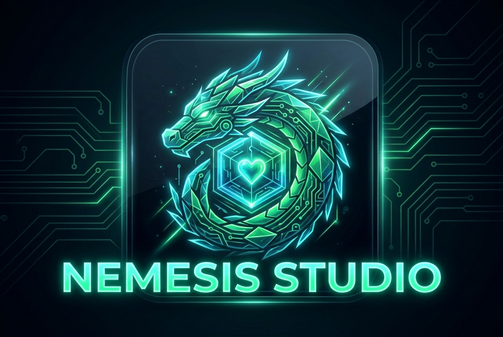

# ⚡ Nemesis Studio
### Production-Grade Autonomous Multi-Agent Software Engineering Engine powered by NVIDIA Nemotron on Nebius Token Factory with Tavily Live Web Intelligence & Self-Healing Runtime

[](https://studio.nebius.ai)
[](https://developer.nvidia.com)
[](https://tavily.com)
[](LICENSE)

<p align="center">
  
</p>

---

## 🌟 Key Highlights
- **Autonomous Architecture Blueprinting:** Powered by `nvidia/Llama-3.1-Nemotron-70B-Instruct` served via Nebius Token Factory.
- **Real-Time Web Intelligence Radar:** Integrated with Tavily Search API for zero-day CVE advisories and live library documentation.
- **Multi-File Code Synthesis:** Generates complete production codebases with configurations, test suites, Dockerfiles, and architecture diagrams.
- **Isolated Virtual Sandbox Runtime:** Executes test matrices with realistic stdout/stderr capture and exit code validation.
- **Interactive Terminal CLI:** Supports in-console diagnostics (`help`, `test`, `nebius status`, `tavily <query>`).
- **Autonomous Self-Healing Loop:** Catches bugs in real-time, analyzes stack traces, synthesizes unified diff patches, and validates green builds without human intervention.
- **Real-Time Telemetry:** Live streaming monitoring of tokens/sec (108+ t/s) and sub-200ms TTFT on Nebius H100 SXM5 clusters.

---

## 🚀 Quick Start

### 1. Prerequisites
- **Node.js** v18+ (tested on Node v20/v26)
- **Python** 3.10+ (optional, for local sandbox execution)

### 2. Setup & Installation
```bash
# Clone or navigate to the repository
cd nemesis-agent-studio

# Install backend dependencies
cd backend
npm install
cd ..

# (Optional) Set your API Keys in .env
cp .env.example .env
# Edit .env and enter NEBIUS_API_KEY and TAVILY_API_KEY
```

> **Note:** Nemesis Studio includes a high-fidelity synthetic cluster simulator out-of-the-box. You can run and test the complete end-to-end multi-agent pipeline immediately even without API keys!

### 3. Launch the Application
```bash
# Start the server
node backend/server.js
```
Open your browser and navigate to:
```
http://localhost:5050
```

---

## 🎯 Production Architecture Templates

Nemesis includes 3 pre-built scenarios for immediate evaluation:

1. **High-Speed Async Microservice (Distributed Systems):**  
   Generates a production FastAPI service with a sliding-window token-bucket rate limiter and Nebius Token Factory SDK. Injects an intentional bug to demonstrate Nemotron reflection and automatic self-healing.
2. **NVIDIA Jetson Edge Telemetry (Edge Computing):**  
   Synthesizes a 15W power-optimized video telemetry streamer for the NVIDIA Jetson Orin Nano with TensorRT-LLM integration.
3. **Autonomous CVE Security Patcher (Autonomous SecOps):**  
   Detects a path traversal vulnerability, queries Tavily for real-time CVE advisories, and applies an automated AST security patch.

---

## 📁 Repository Structure

```
nemesis-agent-studio/
├── backend/
│   ├── server.js               # Express API gateway with SSE streaming & sandbox endpoints
│   ├── package.json            # Node.js dependencies
│   └── services/
│       ├── nebiusClient.js     # Nebius Token Factory API client (api.studio.nebius.ai/v1)
│       ├── tavilyClient.js     # Tavily Search API client (api.tavily.com)
│       ├── sandboxRunner.js    # Isolated sandbox test execution runner
│       └── agentOrchestrator.js# 5-Agent state machine & reflection engine
├── frontend/
│   ├── index.html              # Cyberpunk/Glassmorphism Studio UI
│   ├── css/
│   │   ├── style.css           # Core design system, tokens, and layouts
│   │   └── components.css      # Agent DAG, code editor, terminal CLI & diff viewer
│   ├── js/
│   │   ├── app.js              # Application controller, CLI & agent inspector
│   │   ├── api.js              # SSE streaming client & credential manager
│   │   └── presets.js          # Architecture templates definition
│   └── assets/
│       ├── logo.png            # Application emblem
│       └── hero_banner.jpg     # UI hero artwork
├── docs/
│   ├── ARCHITECTURE.md         # Detailed system architecture 
│   └── Nemesis_Pitch_Deck      # Executive presentation deck
├── Dockerfile                  # Container definition
├── docker-compose.yml          # Container orchestration
├── .env.example                # Environment configuration template
└── README.md                   # Project documentation
```

---

## 📜 License
Distributed under the MIT License. See [LICENSE](LICENSE) for more details.
