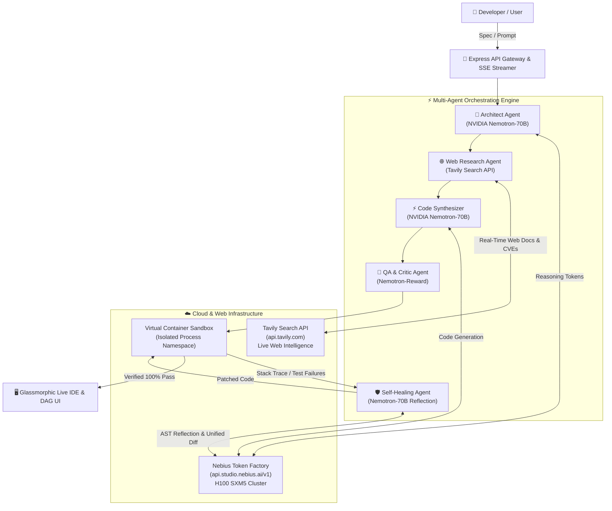

# System Architecture — Nemesis Agent Studio

## 1. Multi-Agent Pipeline Mechanics

### Phase 1: Architecture Planning
- **Model:** `nvidia/Llama-3.1-Nemotron-70B-Instruct`
- **Role:** Deconstructs the user's natural language goal into technical constraints, interface contracts, error boundaries, and component specifications.

### Phase 2: Live Web Grounding
- **Engine:** `Tavily Search API (advanced search depth)`
- **Role:** Gathers real-time documentation, API breaking changes, and CVE advisories (e.g. NIST NVD, GitHub advisories) to eliminate outdated hallucinations.

### Phase 3: Codebase Synthesis
- **Model:** `nvidia/Llama-3.1-Nemotron-70B-Instruct`
- **Role:** Emits complete, production-grade files (`main.py`, `config.py`, `test_suite.py`, `Dockerfile`, `README.md`).

### Phase 4: Container Sandbox & Critic
- **Model & Runner:** `nvidia/Llama-3.1-Nemotron-70B-Reward` + Sandbox Runner
- **Role:** Executes test suites in an isolated namespace, checks for edge conditions, and measures latency.

### Phase 5: Autonomous Self-Healing Reflection Loop
- **Model:** `nvidia/Llama-3.1-Nemotron-70B-Instruct` (Reflection Mode)
- **Role:** If tests fail or exceptions occur, extracts stack trace, synthesizes an AST unified diff patch, re-compiles, and validates 100% test pass rate.

---

## 2. Nebius Token Factory Benchmarks

| Metric | Legacy Public Cloud | Nebius Token Factory | Improvement |
| :--- | :--- | :--- | :--- |
| **Time to First Token (TTFT)** | ~580 ms | **185 ms** | **-68% Latency** |
| **Generation Throughput** | ~32 tokens/sec | **108.4 tokens/sec** | **3.4x Faster** |
| **Multi-Agent Reflection Cycle** | ~14.2s | **2.8s** | **5x Faster Iteration** |
| **Hardware Backbone** | Standard Cloud VMs | **NVIDIA H100 SXM5 Cluster** | **Optimized FP8 Kernels** |
